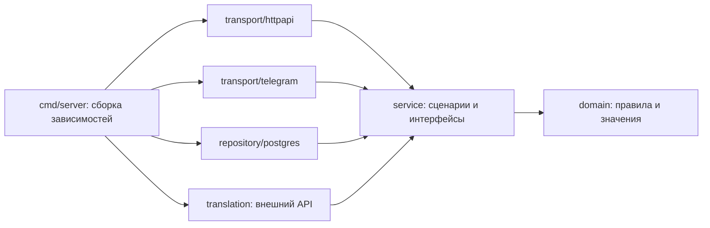

# Архитектура backend

Backend организован по слоям с односторонними зависимостями:



PostgreSQL реализует интерфейсы, которыми владеет приложение. Сервис не импортирует
реализацию репозитория: она передаётся конструктору в `cmd/server/main.go`.
HTTP и Telegram вызывают один и тот же сервис ответа на задание.

## Структура

```text
backend/
├── cmd/server/main.go          # запуск и связывание зависимостей
└── internal/
    ├── config/                 # чтение конфигурации окружения
    ├── domain/                 # нормализация, синонимы, сегментация TXT/WebVTT, ошибки
    ├── service/
    │   ├── auth.go             # регистрация и вход
    │   ├── learning.go         # задания и сохранение ответа
    │   ├── consensus.go        # большинство и экспертные решения
    │   ├── daily_quests.go     # условия и начисление наград
    │   ├── education*.go       # классы, ученики и отчёты
    │   ├── catalog.go          # источники и фрагменты
    │   ├── translations.go     # корпус и экспорт
    │   ├── literature.go       # импорт и публикация текстов
    │   ├── audio.go            # аудиоматериалы
    │   ├── ports_*.go          # типизированные интерфейсы по предметным областям
    │   └── records_*.go        # DTO результатов репозитория, без типов драйвера
    ├── repository/postgres/    # весь SQL, Scan, пул, транзакции и миграции
    ├── transport/httpapi/      # маршруты, JSON/multipart, HTTP-статусы и выдача файлов
    ├── transport/telegram/     # Telegram Bot API и адаптер диалога
    ├── translation/            # HTTP-клиент машинного перевода
    ├── security/               # JWT и криптографические идентификаторы
    ├── architecture/           # тест разрешённых зависимостей
    └── integration/            # тесты с реальной PostgreSQL

db/                            # неизменные номера миграций, читаемый SQL
```

## Ответственность слоёв

**Domain** содержит правила, которые можно проверить без сети, Gin и PostgreSQL:
типографическую нормализацию, объединение одобренных синонимов, нарезку и координаты.

**Service** принимает контекст, пользователя и DTO; проверяет условия сценария,
управляет границей транзакции, начисляет XP и формирует результат. Сервисы не
получают `gin.Context`, не читают SQL-строки, не вызывают `Scan` и не используют pgx.
Ошибки представлены типом `domain.Error`, без HTTP-статусов.

**Repository/PostgreSQL** выполняет именованные операции с типизированными
аргументами и результатами. Маппинг строк и ошибки драйвера остаются здесь.
Ни произвольные SQL-строки, ни курсоры, ни pgx-типы не передаются в приложение.
Интерфейсы разделены по областям: авторизация, обучение, материалы, классы и т.д.

**Transport** читает JSON/multipart, извлекает actor/ID/фильтры и вызывает сервис.
Только HTTP-адаптер переводит ошибки в 4xx/5xx и обслуживает Range-аудио.
Telegram имеет внедряемый HTTP-клиент; тесты заменяют транспорт без глобальных переменных.

**Composition root** создаёт пул, применяет миграции, создаёт JWT-сервис, репозиторий,
ИИ-клиент, прикладной сервис и адаптеры. Глобального `db` и глобального JWT-секрета нет.

## Транзакции

Порядок блокировок при ответе: задание → пользователь → фрагмент.
Модерация блокирует фрагмент перед записью спора. Ответ, XP, цели, согласование
и квитанция для идемпотентного повтора сохраняются одной транзакцией.
Уникальные ограничения защищают task_id, idempotency_key и награды.
Решение эксперта не перезаписывается автоматическим большинством.

## Миграции

Файлы `db/*.sql` сохраняют номера, порядок и DDL/DML предыдущей версии;
изменено форматирование. Столбцы и ограничения таблиц записаны отдельно.
`schema_migrations` сохраняет применённые имена; каждый новый файл выполняется
в транзакции. Advisory lock сериализует запуск нескольких экземпляров backend.
Проверяются чистая установка и повторный запуск миграций.

## Проверки границ

`internal/architecture/dependencies_test.go` запрещает зависимости domain от
инфраструктуры, импорты Gin/pgx/репозитория в service, доступ транспорта к PostgreSQL
и SQL за пределами PostgreSQL-адаптера. Тесты сервисов используют подмену
прикладного интерфейса репозитория; PostgreSQL для них не требуется.

## Ограничения MVP

Ограничитель входа действует в рамках экземпляра; для нескольких реплик нужен общий
лимит на reverse proxy. Аудио хранится в bytea до 20 МБ; при росте стоит использовать
объектное хранилище. День — UTC. Фактическая экспертиза, права на материалы и
проверка внешних Telegram/ИИ требуют рабочих данных и ключей.
